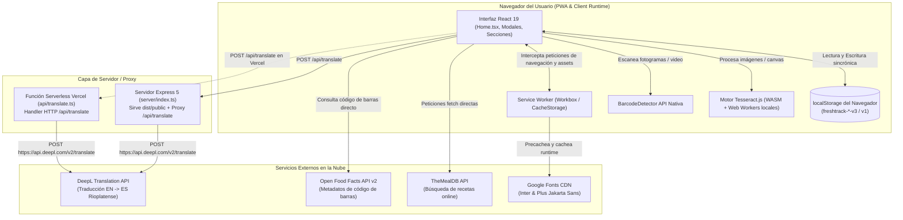
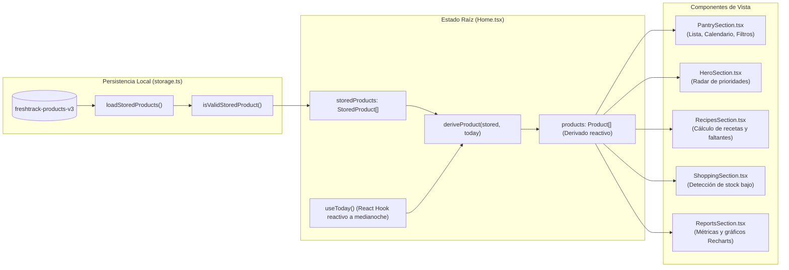
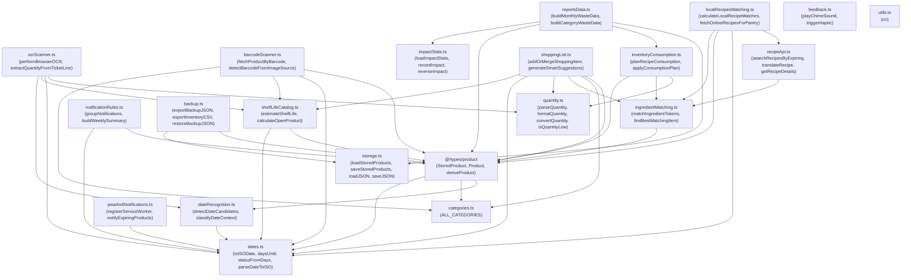

# Arquitectura del Sistema

Este documento describe la arquitectura global de FreshTrack, detallando la interacción entre la aplicación web progresiva (PWA), el Service Worker, los puntos de entrada del servidor (Express y Vercel Serverless), los servicios externos consumidos y el flujo unidireccional de datos de estado en el cliente.

---

## 1. Diagrama General de Componentes

FreshTrack adopta un modelo arquitectónico desacoplado donde el frontend asume casi la totalidad de la lógica de negocio, persistencia e inferencia visual. El backend existe exclusivamente como servidor de archivos estáticos y como un proxy HTTP liviano hacia la API de traducción de DeepL, protegiendo la clave de API y evitando restricciones de CORS.

---

## 2. Flujo de Datos y Separación StoredProduct vs. Product

Una de las decisiones arquitectónicas fundamentales de FreshTrack radica en la estricta separación entre el estado persistido en disco (`StoredProduct`) y el estado proyectado para la presentación (`Product`).

### ¿Por qué existe esta separación?
1. **Invariabilidad temporal**: Si se guardara en `localStorage` el campo `days: 3` (días restantes), al abrir la aplicación dos días después el valor persistido estaría desactualizado y sería falso.
2. **Determinismo por hora local**: La fecha de vencimiento persistida es una cadena ISO fija en formato fecha (`YYYY-MM-DD`, por ejemplo `"2026-10-15"`).
3. **Cálculo dinámico respecto a `today`**: Al iniciar la aplicación o cuando el reloj del dispositivo cruza la medianoche (manejado por el hook `useToday()` en `client/src/lib/dates.ts`), la función `deriveProduct()` toma cada `StoredProduct` y recalcula en memoria:
   - `days`: Cantidad exacta de días calendario entre la medianoche de hoy y la fecha objetivo.
   - `status`: Categoría de semáforo (`"ok"` si `days > 3`, `"soon"` si `0 <= days <= 3`, o `"expired"` si `days < 0`).
   - `expiry`: Cadena textual formateada para el usuario (ej. `"18 sep"` o `"12 ago 27"` si el año difiere del actual).

### Tabla Comparativa de Modelos

| Propiedad | `StoredProduct` (`client/src/types/product.ts`) | `Product` (`client/src/types/product.ts`) |
| :--- | :--- | :--- |
| `id` | `number` (identificador único numérico) | `number` |
| `name` | `string` (ej. "Leche entera") | `string` |
| `category` | `ProductCategory \| string` | `ProductCategory \| string` |
| `expiryDate` | `string` (formato ISO `YYYY-MM-DD`) | `string` (formato ISO `YYYY-MM-DD`) |
| `quantity` | `string` (ej. "1 litro", "500 g") | `string` |
| `icon` | `string` (emoji representativo) | `string` |
| `location` | `string?` ("Heladera", "Alacena", etc.) | `string?` |
| `state` | `"cerrado" \| "abierto"` | `"cerrado" \| "abierto"` |
| `openedAt` | `string?` (ISO `YYYY-MM-DD`) | `string?` |
| `days` | **No existe** (evita desfasajes en disco) | `number` (diferencia de días calculada al vuelo) |
| `status` | **No existe** | `"ok" \| "soon" \| "expired"` |
| `expiry` | **No existe** | `string` (representación amigable ej. "15 oct") |

---

## 3. Grafo de Dependencias entre Módulos de `lib/`

La carpeta `client/src/lib/` concentra la lógica pura del negocio culinario, visión artificial, conversiones de unidades y gestión del almacenamiento. A continuación se presenta el mapa completo de dependencias entre sus módulos:

---

## 4. Roles y Responsabilidades por Capa

### Capa de Presentación (`client/src/components/` y `client/src/pages/`)
- `pages/Home.tsx` actúa como controlador principal y orquestador del estado en memoria (`products`, `storedProducts`, `shoppingList`, `impactStats`, etc.).
- Utiliza subcomponentes modulares dentro de `components/home/` (`PantrySection`, `RecipesSection`, `ReportsSection`, `ShoppingSection`, `HeroSection`, `StatsSection`, `MobileBottomNav`) a los que alimenta mediante props fuertemente tipadas y callbacks.
- Las primitivas accesibles en `components/ui/` (`dialog.tsx`, `tooltip.tsx`, `button.tsx`, `card.tsx`, `sonner.tsx`) proporcionan la base WAI-ARIA mediante Radix UI.

### Capa de Lógica de Dominio (`client/src/lib/`)
- Contiene funciones puras para matemáticas de fechas, reglas bromatológicas de vida útil, singularización y sinónimos de ingredientes, y balances de masas y volúmenes.
- Aísla completamente el cálculo matemático del renderizado visual de React, permitiendo una cobertura de pruebas unitarias rápida y determinística.

### Capa de Almacenamiento Local (`client/src/lib/storage.ts`)
- Encapsula el acceso a la Web Storage API (`localStorage`).
- Implementa salvaguardas de migración hacia atrás (`v1` y `v2` a `v3`), validación de esquemas en tiempo de ejecución (`isValidStoredProduct`) y protección ante cuota de disco excedida.

### Capa de Servidor y Gateway (`server/` y `api/`)
- **Desarrollo**: Vite ejecuta el plugin interno `apiTranslatePlugin()` definido en `vite.config.ts`, permitiendo depurar la traducción de recetas localmente sin compilar el servidor.
- **Producción tradicional (Node.js)**: `server/index.ts` ejecuta Express 5, sirve los archivos estáticos optimizados de `dist/public`, inyecta encabezados HTTP específicos para Service Worker (`Service-Worker-Allowed: /`) y responde a `/api/translate` aplicando control de tasa por IP y caché en memoria de 24 horas.
- **Producción serverless (Vercel)**: La función `api/translate.ts` atiende las peticiones POST de `/api/translate` bajo demanda, mientras que `vercel.json` se encarga del ruteo estático hacia `dist/public`.

---

## Enlaces Relacionados
- [Visión General](01-vision-general.md)
- [Modelo de Datos y Almacenamiento](06-modelo-de-datos-y-almacenamiento.md)
- [Referencia de Módulos lib/](07-referencia-de-modulos-lib.md)
- [Jerarquía de Componentes UI](08-componentes-ui.md)
- [Despliegue y Hosting](12-despliegue.md)
- [Limitaciones y Deuda Técnica](14-limitaciones-y-deuda-tecnica.md)
