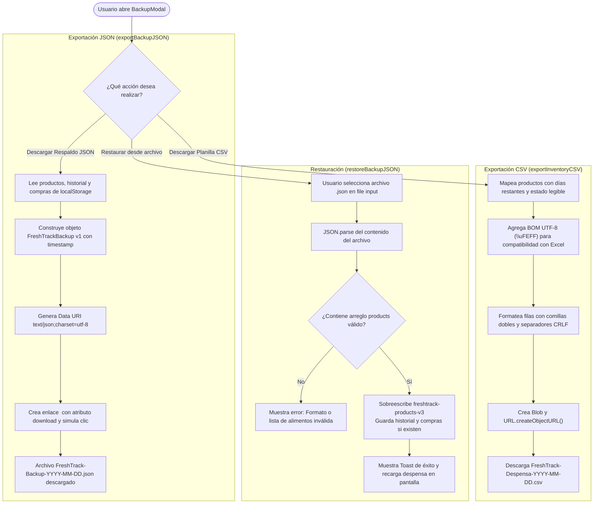

# Funcionalidad: Respaldo, Restauración y Exportación

Este documento describe los mecanismos de exportación en formatos abiertos (JSON y CSV) y restauración de copias de seguridad en FreshTrack, detallando la estructura de los datos resguardados, la codificación de caracteres y el alcance actual del respaldo.

---

## 1. Perspectiva del Usuario

Al operar sin base de datos central ni cuentas de usuario en la nube, FreshTrack otorga soberanía total de la información al usuario a través del modal de Respaldo (`BackupModal`):
- **Descargar copia de seguridad completa (JSON)**: Genera un archivo `.json` formateado que contiene el inventario de la despensa, el historial de preparaciones cocinadas y la lista de compras actual.
- **Exportar despensa en planilla de cálculo (CSV)**: Descarga un archivo `.csv` compatible de forma nativa con Microsoft Excel, Google Sheets y LibreOffice Calc, con columnas claras (Nombre, Categoría, Ubicación, Cantidad, Fecha Vencimiento, Días Restantes, Estado, Envase).
- **Restaurar copia de seguridad**: Permite seleccionar un archivo `.json` de respaldo previamente generado para recuperar el inventario en un nuevo dispositivo o tras limpiar la memoria caché del navegador.

---

## 2. Flujo de Respaldo y Restauración



---

## 3. Estructura del Archivo de Respaldo (`FreshTrackBackup`)

El archivo JSON de respaldo sigue la interfaz `FreshTrackBackup` definida en `client/src/lib/backup.ts`:

```typescript
export interface FreshTrackBackup {
  version: number;             // Versión del formato de respaldo (fijado en 1)
  exportedAt: string;          // Timestamp ISO de exportación (ej. "2026-10-05T20:30:00.000Z")
  products: StoredProduct[];   // Arreglo completo de alimentos en despensa
  consumptionHistory: any[];   // Historial de consumos realizados
  shoppingList: any[];         // Ítems presentes en la lista de compras
  theme?: string;              // Tema visual del usuario ("light" o "dark")
}
```

### Ejemplo de Archivo de Respaldo Generado
```json
{
  "version": 1,
  "exportedAt": "2026-10-05T18:45:00.000Z",
  "products": [
    {
      "id": 101,
      "name": "Leche entera",
      "category": "Lácteos",
      "expiryDate": "2026-10-20",
      "quantity": "2 litros",
      "icon": "🥛",
      "location": "Heladera",
      "state": "cerrado"
    }
  ],
  "consumptionHistory": [],
  "shoppingList": [
    {
      "id": "item-1728153900000",
      "name": "Huevos",
      "category": "Almacén seco",
      "quantity": "1 docena",
      "completed": false,
      "reasons": ["stock_bajo"]
    }
  ],
  "theme": "light"
}
```

---

## 4. Exportación en Planilla CSV (`exportInventoryCSV`)

Para garantizar que el archivo CSV se abra correctamente en Microsoft Excel en Windows y macOS sin romper caracteres especiales del español (como acentos, eñes o diéresis), `exportInventoryCSV()` implementa dos técnicas fundamentales:

1. **Byte Order Mark (BOM UTF-8)**: El archivo comienza con el caracter `\uFEFF`, indicando al visor de planillas que el archivo está codificado en UTF-8 y debe interpretar los acentos directamente.
2. **Escape y Delimitadores Estándar**:
   - Cada campo de texto se encierra entre comillas dobles y se escapan comillas internas (`"Ejemplo"` $\rightarrow$ `""Ejemplo""`).
   - Los saltos de línea utilizan la convención estándar `\r\n` (CRLF).
   - Columnas incluidas: `"Nombre"`, `"Categoría"`, `"Ubicación"`, `"Cantidad"`, `"Fecha Vencimiento"`, `"Días Restantes"`, `"Estado"` (*En fecha*, *Por vencer*, *Vencido*) y `"Envase"` (*Abierto*, *Cerrado*).

---

## 5. Análisis de Cobertura de Datos en el Respaldo

Al analizar el código fuente de `client/src/lib/backup.ts`, se evidencia qué datos se incluyen actualmente en la copia de seguridad y cuáles quedan omitidos:

| Clave de Almacenamiento | Contenido | ¿Se incluye en el Backup? | Observación Técnica |
| :--- | :--- | :---: | :--- |
| `freshtrack-products-v3` | Alimentos en despensa | **Sí** | Se exporta el arreglo completo de `StoredProduct`. |
| `freshtrack-consumption-history-v3` | Historial de consumos | **Sí** | Se incluye el historial para permitir reversiones futuras. |
| `freshtrack-shopping-list-v1` | Lista de compras | **Sí** | Se respaldan todos los ítems pendientes y completados. |
| `theme` | Tema claro / oscuro | **Parcialmente** | `backup.ts` intenta leer `freshtrack-theme`, pero `ThemeContext.tsx` guarda en `theme` (ver deuda técnica). |
| `freshtrack-impact-stats-v1` | Métricas de impacto | **No** | Queda excluido; al restaurar en otro dispositivo el mes parte de cero. |
| `freshtrack-expired-history-v1` | Registro histórico de vencidos | **No** | Queda excluido; los gráficos de descartes no recuperan historial pasado. |
| `freshtrack-monthly-impact-history-v1` | Historial mensual | **No** | Queda excluido de la exportación JSON. |
| `freshtrack-shelf-corrections-v1` | Ajustes de vida útil del usuario | **No** | Queda excluido; el usuario debe reajustar sus preferencias personalizadas. |
| `freshtrack-date-learning-v1` | Reglas de aprendizaje OCR | **No** | Queda excluido de la exportación JSON. |
| `freshtrack-notification-preferences-v1` | Preferencias de alertas | **No** | Queda excluido; se aplican los valores por defecto al restaurar. |

*(Esta omisión está registrada detalladamente en el documento de [Limitaciones y Deuda Técnica](../14-limitaciones-y-deuda-tecnica.md)).*

---

## 6. Proceso de Restauración y Validación

La función `restoreBackupJSON(jsonText)` ejecuta las siguientes validaciones antes de impactar el almacenamiento:
1. Verifica que la cadena sea un objeto JSON parseable.
2. Comprueba que el campo `products` exista y sea un arreglo (`Array.isArray(data.products)`).
3. Si la verificación tiene éxito, escribe directamente en `freshtrack-products-v3` mediante `saveJSON()`.
4. Si existen arreglos en `consumptionHistory` y `shoppingList`, los resguarda en sus respectivas claves de almacenamiento.
5. Retorna `{ success: true, count: N }` o un mensaje de error legible para el usuario.

---

## 7. Casos Borde

- **Archivo JSON truncado o corrupto**: La función envuelve `JSON.parse` en un bloque `try/catch` y devuelve `{ success: false, message: "Error al leer la copia de seguridad..." }`, mostrando una alerta Toast roja sin romper el estado de la aplicación.
- **Sin validación profunda de ítems individuales**: Como se señala en la deuda técnica, `restoreBackupJSON()` no pasa los elementos por `isValidStoredProduct()`, por lo que un archivo JSON adulterado manualmente podría persistir campos incompletos si no se sanea previamente.

---

## 8. Pruebas que Cubren esta Funcionalidad

- Pruebas manuales de exportación y compatibilidad de planillas CSV en Microsoft Excel y Google Sheets.
- Las pruebas de `dates.test.ts` y `storage.ts` validan las claves de almacenamiento consumidas por este módulo.

---

## Enlaces Relacionados
- [Funcionalidad: Despensa](despensa.md)
- [Modelo de Datos y Almacenamiento](../06-modelo-de-datos-y-almacenamiento.md)
- [Referencia de Módulos lib/](../07-referencia-de-modulos-lib.md)
- [Limitaciones y Deuda Técnica](../14-limitaciones-y-deuda-tecnica.md)
