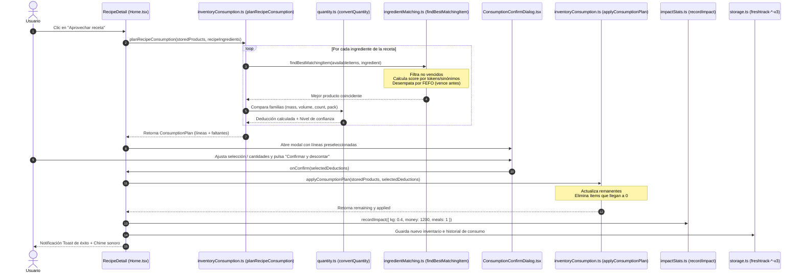

# Funcionalidad: Consumo de Ingredientes y Deducción Inteligente

Este documento describe el mecanismo de deducción de inventario de FreshTrack al preparar recetas o registrar comidas, abarcando la planificación de descuentos, la conversión de unidades culinarias, el desempate por FEFO (*First Expired, First Out*), la confirmación interactiva y la reversión histórica (*undo*).

---

## 1. Perspectiva del Usuario

Cuando el usuario decide cocinar una receta, no necesita restar manualmente los gramos o unidades de cada ingrediente:
1. Al tocar **"Aprovechar receta"** en el detalle de cualquier plato, se despliega el diálogo de confirmación de deducciones (`ConsumptionConfirmDialog`).
2. El sistema calcula qué ingredientes de la despensa coinciden con la receta y sugiere automáticamente cuánto descontar.
3. El usuario puede desmarcar ingredientes específicos si no los usó o editar la cantidad a descontar antes de confirmar.
4. Al confirmar, los alimentos consumidos en su totalidad se eliminan de la despensa y los que tienen remanente actualizan su cantidad.
5. Se reproduce un sonido de éxito (*chime* upward), se activa una vibración háptica en móviles y se suman métricas de impacto positivo (0.4 kg de comida salvada, $1.200 ahorrados y 1 plato evitado de la basura).
6. Si el usuario se equivocó o canceló la preparación, puede ir a la sección de Reportes y tocar el botón **"Deshacer"** en el historial para restaurar el inventario exactamente a su estado previo.

---

## 2. Flujo Completo de Consumo y Deducción

---

## 3. Niveles de Confianza de Consumo (`ConsumptionConfidence`)

Cada línea del plan de consumo recibe una calificación que determina si se autoselecciona por defecto en la interfaz:

| Nivel de Confianza | Criterio Técnico | Estado por Defecto |
| :--- | :--- | :---: |
| **`exact`** | La unidad del ingrediente y la del alimento en despensa coinciden exactamente (ej. 2 unidades de huevo vs 6 unidades en stock; o 200 g de harina vs 1 kg en stock). | **Seleccionado** |
| **`converted`** | Las unidades pertenecen a la misma familia física y pudieron convertirse matemáticamente sin ambigüedad (ej. 1 taza de leche [240 ml] contra 1 litro en stock; o 500 g de carne contra 1,5 kg). | **Seleccionado** |
| **`assumed`** | Condimentos no numéricos o sazones al gusto (ej. *"sal a gusto"*, *"pimienta"*, *"pizca de orégano"*). Coinciden con el producto pero su deducción se fija en `null` para no restar inventario arbitrariamente. | **No seleccionado** |
| **`manual`** | El sistema no pudo determinar la equivalencia entre familias distintas (ej. *"2 cucharadas"* contra *"1 paquete"*). Requiere que el usuario defina manualmente la cantidad a descontar. | **No seleccionado** |

---

## 4. Desempate por Inocuidad Culinaria: FEFO (*First Expired, First Out*)

Si el usuario tiene múltiples lotes del mismo alimento en su despensa (por ejemplo, dos paquetes de leche o tres latas de tomate con diferentes fechas de caducidad), la función `findBestMatchingItem()` en `ingredientMatching.ts` implementa una política estricta de **FEFO**:

1. Filtra y excluye incondicionalmente cualquier alimento con estado `expired` o con fecha anterior a hoy.
2. Evalúa las coincidencias lingüísticas y sinónimos por tokens.
3. Si dos o más alimentos obtienen el mismo puntaje de coincidencia, **el sistema elige el que tenga la fecha de vencimiento (`expiryDate`) más cercana en el tiempo**. De este modo, la receta consume siempre el lote más perecedero, preservando los de mayor vida útil.

---

## 5. Conversión de Unidades (`quantity.ts`)

El módulo `quantity.ts` organiza las medidas culinarias en 4 familias disjuntas:

### Familias Físicas
- **`mass` (Masa)**: Gramos (`g`), kilogramos (`kg`), onzas (`oz`), libras (`lb`).
- **`volume` (Volumen)**: Mililitros (`ml`), litros (`l`), centímetros cúbicos (`cc`), cucharaditas (`5 ml`), cucharadas (`15 ml`), tazas (`240 ml`).
- **`count` (Conteo)**: Unidades (`u`), docenas (`12 unidades`).
- **`pack` (Envases)**: Paquetes, atados, bandejas, potes, latas, botellas, cajas, sachets, bolsas.

La conversión solo se realiza entre unidades de la **misma familia**. No se aplican conversiones cruzadas de masa a volumen (como gramos a mililitros) salvo que se cuente con tablas de densidad específicas, evitando cálculos erróneos en harinas o aceites.

---

## 6. Reversión Histórica Atómica (*Undo*)

Cada operación de consumo exitosa genera un registro inmutable en `freshtrack-consumption-history-v3` con el tipo `ConsumptionRecord`:
- `id`: Timestamp numérico único.
- `title`: Título de la receta o motivo de consumo.
- `ingredients`: Nombres de los ingredientes consumidos.
- `before`: Snapshot completo de los `StoredProduct[]` antes de aplicar la deducción.
- `applied`: Lista de deducciones realizadas con `itemId` y texto de cantidad.
- `delta`: Métricas asociadas (`kg`, `money`, `meals`).

Cuando el usuario pulsa **"Deshacer"** en un registro:
1. La función `undoConsumptionHistory(records, targetRecordId)` toma el snapshot `before` del registro objetivo.
2. Si existieron consumos posteriores a ese registro, los vuelve a reproducir de forma secuencial aplicando únicamente sus deducciones correspondientes por `itemId`.
3. Se invoca `reverseImpact()` en `impactStats.ts` para restar los kilogramos y dinero salvados de ese registro específico.
4. El inventario resultante se guarda en disco y se actualiza el estado de la aplicación sin recargar la página.

---

## 7. Casos Borde

- **Alimento agotado por completo**: Si la resta arroja un remanente menor o igual a $0.001$, el producto se marca como agotado (`willDeplete: true`) y se elimina del inventario activo.
- **Varios ingredientes de una misma receta que consumen el mismo alimento**: `planRecipeConsumption` mantiene una copia de trabajo (`workingItems`). Si una receta pide `"1 taza de leche"` para la masa y `"1/2 taza de leche"` para el relleno, ambas líneas descuentan sucesivamente del mismo producto en despensa sin colisiones.
- **Fracciones culinarias y caracteres Unicode**: El analizador numérico de `quantity.ts` reconoce de forma nativa caracteres como `½`, `¼`, `¾`, `⅓`, `⅔` y combinaciones mixtas (`"1 1/2 taza"` $\rightarrow$ `1.5 tazas`).

---

## 8. Pruebas que Cubren esta Funcionalidad

- `client/src/tests/inventoryConsumption.test.ts`: Pruebas exhaustivas de planificación, niveles de confianza, descarte de vencidos y cálculo de remanentes.
- `client/src/tests/inventoryConsumption.integration.test.ts`: Simulación completa de consumo, persistencia de snapshots y reversión histórica con múltiples registros encadenados.
- `e2e/freshtrack.spec.ts`: Prueba interactiva de consumo de receta con confirmación modal y verificación del mensaje toast final.

---

## Enlaces Relacionados
- [Funcionalidad: Recetas y Aprovechamiento](recetas.md)
- [Funcionalidad: Despensa](despensa.md)
- [Funcionalidad: Reportes e Impacto](reportes-e-impacto.md)
- [Referencia de Módulos lib/](../07-referencia-de-modulos-lib.md)
