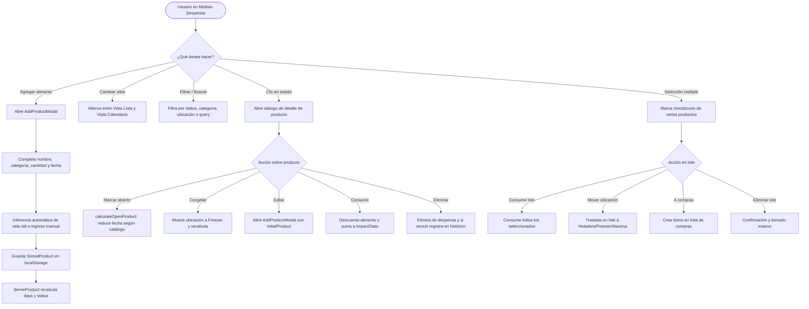

# Funcionalidad: Despensa e Inventario

Este documento describe la arquitectura, interacción del usuario y reglas de negocio del módulo de Despensa de FreshTrack, encargado del seguimiento del ciclo de vida de los alimentos en el hogar, el control de ubicaciones, estados de envase y operaciones por lote.

---

## 1. Perspectiva del Usuario

La despensa es el núcleo operativo de FreshTrack. Desde esta sección, el usuario puede:
- Ver todos sus alimentos organizados en una lista visual con tarjetas o en un calendario semanal interactivo.
- Identificar al instante el estado de urgencia mediante semáforos de color (`ok`: verde, `soon`: ámbar, `expired`: rojo carmesí) y conteo de días relativos ("vence hoy", "vence mañana", "en 5 días").
- Filtrar por estado de caducidad, categoría bromatológica (15 categorías disponibles) o ubicación física de almacenamiento ("Heladera", "Freezer", "Alacena", "Cajón verduras").
- Buscar rápidamente por texto con normalización de acentos y caracteres especiales.
- Ordenar por fecha de vencimiento (ascendente/descendente), nombre alfabético o categoría.
- Cambiar el estado de un envase de "Cerrado" a "Abierto", recalculando automáticamente los días inocuos restantes.
- Seleccionar múltiples productos en simultáneo para consumirlos, eliminarlos, moverlos de ubicación o transferirlos a la lista de compras con un solo clic.
- Cargar un inventario de demostración con 7 alimentos equilibrados si la despensa se encuentra vacía.

---

## 2. Flujo de Trabajo y Operaciones

---

## 3. Módulos y Componentes Involucrados

| Componente / Módulo | Archivo | Responsabilidad |
| :--- | :--- | :--- |
| `PantrySection` | `client/src/components/home/PantrySection.tsx` | Contenedor principal de la sección: barra de filtros, buscador, toggle lista/calendario, barra de acciones en lote y renderizado de filas. |
| `ProductRow` | `client/src/components/home/ProductRow.tsx` | Representación de cada ítem en la lista: semáforo de estado, insignia de envase abierto, cantidad editable y menú de acciones. |
| `WeekCalendar` | `client/src/components/home/WeekCalendar.tsx` | Renderizado visual de los próximos 7 días de la semana con distribución de productos por día de vencimiento. |
| `AddProductModal` | Declarado en `client/src/pages/Home.tsx` (líneas 381-580) | Modal polimórfico utilizado tanto para el alta manual de productos como para la edición de existentes (cuando recibe `initialProduct`). |
| `shelfLifeCatalog.ts` | `client/src/lib/shelfLifeCatalog.ts` | Proveedor de duraciones estándar (`estimateShelfLife`), catálogo ANMAT/USDA y recálculo por apertura (`calculateOpenProduct`). |
| `storage.ts` | `client/src/lib/storage.ts` | Persistencia en `freshtrack-products-v3` y validación de integridad (`isValidStoredProduct`). |
| `dates.ts` | `client/src/lib/dates.ts` | Funciones `daysUntil`, `statusFromDays`, `formatExpiryDisplay` y `formatRelativeDays`. |

---

## 4. Reglas de Negocio Clave

1. **Determinación de Estado (Semáforo)**:
   - `expired`: Cuando `days < 0` (la fecha límite ya pasó respecto a la medianoche local).
   - `soon`: Cuando `0 <= days <= SOON_THRESHOLD_DAYS` (donde `SOON_THRESHOLD_DAYS = 3`).
   - `ok`: Cuando `days > 3`.
2. **Inferencia de Ubicación Inicial**:
   - Por defecto, se infiere según la categoría del producto:
     - "Congelados" $\rightarrow$ **Freezer**.
     - "Lácteos", "Carnes", "Pescados y mariscos", "Fiambres y embutidos", "Refrigerados preparados" $\rightarrow$ **Heladera**.
     - "Verduras frescas", "Frutas frescas" $\rightarrow$ **Cajón verduras**.
     - El resto $\rightarrow$ **Alacena**.
   - El usuario siempre puede sobreescribir la ubicación con una personalizada.
3. **Paso a Estado "Abierto" (`calculateOpenProduct`)**:
   - Asigna `openedAt = todayISO(today)` y `state = "abierto"`.
   - Consulta el catálogo de vida útil para obtener `openDays`.
   - La nueva fecha es: `Math.min(expiryDateActual, hoy + openDays)`. **Regla crítica**: nunca se extiende la vida útil de un producto por abrirlo; la fecha solo puede adelantarse o mantenerse.
4. **Registro Histórico de Vencidos**:
   - Cuando un producto con estado `expired` o `days <= 0` es eliminado manualmente o por lote, se invoca `recordExpiredItem(name, category)` en `client/src/lib/reportsData.ts`, guardándolo en `freshtrack-expired-history-v1` para alimentar los gráficos de desperdicio histórico.

---

## 5. Casos Borde y Manejo de Errores

- **Producto sin fecha explícita**: En el alta manual, si el usuario escribe un nombre sin fecha, el sistema consulta `estimateShelfLife()`. Si encuentra coincidencia o categoría, autocompleta la fecha sugerida y marca `estimated: true`.
- **Cantidad con texto mixto**: Si el usuario tipea `"1 paquete grande"`, `parseQuantity()` extrae `amount: 1`, `family: "pack"` y `unit: "paquete"`, formateando la cantidad sin bloquear la entrada.
- **Lista vacía**: Si `products.length === 0`, `PantrySection` despliega un estado vacío amigable con un botón directo para cargar los 7 productos de demostración (`buildDemoProducts()`).
- **Fecha en año distinto**: Si un producto de almacén seco vence en un año calendario posterior al corriente, `formatExpiryDisplay` incluye los dos dígitos del año (ej. `"12 ago 27"`).

---

## 6. Pruebas que Cubren esta Funcionalidad

- `client/src/tests/dates.test.ts`: Pruebas de cálculo de días calendario locales, transiciones entre estados `ok`, `soon` y `expired`, y migración de esquemas v2 a v3.
- `client/src/tests/openProduct.test.ts`: Validación exhaustiva del recálculo de fecha al abrir envases y verificación de que la fecha nunca se extienda.
- `client/src/tests/shelfLife.test.ts`: Comprobación de asignación de días según catálogo FoodKeeper/ANMAT y mínimos conservadores.
- `e2e/freshtrack.spec.ts`: Auditoría de accesibilidad Axe en el diálogo de alta manual (`AddProductModal`), prueba de responsive en vista móvil (320px/375px) y barra de navegación inferior.

---

## Enlaces Relacionados
- [Funcionalidad: Vida Útil y Fechas](vida-util-y-fechas.md)
- [Funcionalidad: Escaneo OCR y Código de Barras](escaneo-ocr-y-codigo-de-barras.md)
- [Modelo de Datos y Almacenamiento](../06-modelo-de-datos-y-almacenamiento.md)
- [Referencia de Módulos lib/](../07-referencia-de-modulos-lib.md)
