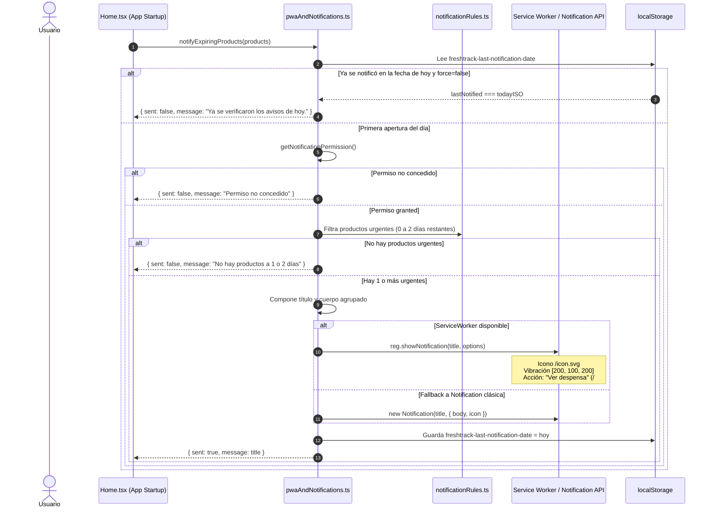

# Funcionalidad: Notificaciones y Alertas Preventivas

Este documento describe el sistema de avisos de FreshTrack, su estrategia de prevención sin saturación (*anti-spam*), la configuración de umbrales por categoría de alimento, la agrupación por fecha y el resumen semanal.

---

## 1. Perspectiva del Usuario

FreshTrack adopta una filosofía de avisos preventivos sin saturar la atención del usuario:
- **Alertas agrupadas**: En lugar de enviar una notificación individual por cada alimento que vence, el sistema agrupa los productos que vencen el mismo día en un solo aviso claro (ej. *"Leche entera y 2 productos más vencen mañana"*).
- **Límite estricto de una notificación al día**: No se disparan alertas repetitivas durante la jornada. Una vez que se verificó la despensa hoy, no se volverán a enviar avisos hasta el día siguiente.
- **Anticipación personalizada según el alimento**: Los productos altamente perecederos (como carnes frescas) avisan con 1 día de antelación; los lácteos y verduras con 3 días; y los alimentos no perecederos de almacén con 7 días para dar margen de maniobra.
- **Resumen semanal**: El usuario puede recibir un consolidado los domingos o lunes para planificar las comidas de la semana antes de salir a hacer las compras.

---

## 2. Flujo de Emisión de Notificaciones



---

## 3. Configuración de Anticipación por Categoría

La interfaz permite calibrar los días de anticipación de alerta (`AlertLeadDays`: 1, 3 o 7 días) según la naturaleza bromatológica de cada grupo de alimentos:

| Categoría | Anticipación por Defecto | Justificación Bromatológica |
| :--- | :---: | :--- |
| **Carnes**, **Pescados y mariscos**, **Refrigerados preparados**, **Panadería** | **1 día** | Alimentos de consumo inmediato con rápida degradación microbiana o sensorial. |
| **Lácteos**, **Fiambres y embutidos**, **Verduras frescas**, **Frutas frescas** | **3 días** | Margen adecuado para incorporar a ensaladas, salteados, purés o licuados antes de que maduren en exceso. |
| **Almacén seco**, **Enlatados**, **Congelados**, **Salsas**, **Snacks**, **Bebidas**, **Café y té** | **7 días** | Productos estables que dan tiempo para planificar compras o utilizarlos en recetas de fin de semana. |

Las preferencias se persisten en `freshtrack-notification-preferences-v1` bajo la interfaz `NotificationPreferences`:
```typescript
export type NotificationPreferences = {
  enabled: boolean;
  weeklySummary: boolean;
  summaryDay: "domingo" | "lunes";
  categoryLeadDays: Record<string, AlertLeadDays>;
};
```

---

## 4. Agrupación y Resumen Semanal

### Agrupación por Fecha (`groupNotifications`)
Para evitar el bombardeo de notificaciones, la función `groupNotifications(items, preferences, today)`:
1. Filtra los productos que requieren acción (vencidos, alimentos abiertos con $\le 2$ días, o con días restantes inferiores al `leadDays` de su categoría).
2. Agrupa los productos en un `Map` indexado por su fecha ISO (`expiryDate`).
3. Ordena cronológicamente las fechas y genera un título consolidado:
   - 1 producto: `"[Nombre] vence [Fecha]"`
   - 2 o más: `"N productos vencen [Fecha]"`

### Resumen Semanal (`buildWeeklySummary`)
Genera un informe sintético para el día elegido por el usuario (domingo o lunes):
- Si hay productos por caducar: `"N productos para planificar esta semana"`, detallando la lista completa sin generar alertas dispersas.
- Si no hay vencimientos próximos: `"Tu semana está despejada"`.

---

## 5. Casos Borde y Manejo de Errores

- **Navegador sin soporte de Notification API**: `getNotificationPermission()` retorna `"unsupported"`, y los botones de configuración de notificaciones informan que el navegador no soporta esta capacidad sin arrojar excepciones.
- **Permiso denegado por el usuario**: Si el usuario rechazó el permiso previamente en el diálogo del navegador, la aplicación desactiva visualmente el toggle y muestra cómo rehabilitarlo desde la configuración del sitio.
- **Forzado para pruebas (`force = true`)**: La función `notifyExpiringProducts` incluye el parámetro opcional `force` para permitir a los desarrolladores o usuarios en modo de prueba emitir una notificación de prueba saltando el límite diario de una por jornada.
- **Limpieza del límite diario (`clearNotificationDailyLimit`)**: Función utilitaria que remueve la clave `freshtrack-last-notification-date` para facilitar ciclos de test manuales.

---

## 6. Pruebas que Cubren esta Funcionalidad

- `client/src/tests/notificationRules.test.ts` (integrado en suites de dominio): Pruebas de agrupamiento de notificaciones por fecha, aplicación de días de anticipación por categoría y armado del resumen semanal.
- `client/src/tests/dates.test.ts`: Pruebas de formateo de fechas relativas para los mensajes de notificación.

---

## Enlaces Relacionados
- [Funcionalidad: Despensa](despensa.md)
- [Funcionalidad: Vida Útil y Fechas](vida-util-y-fechas.md)
- [PWA y Estrategias Offline](../10-pwa-y-offline.md)
- [Modelo de Datos y Almacenamiento](../06-modelo-de-datos-y-almacenamiento.md)
