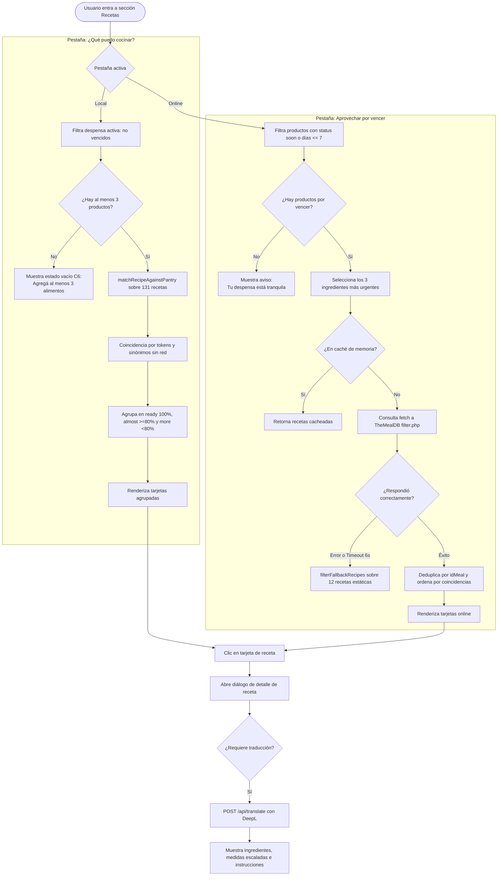

# Funcionalidad: Recetas y Aprovechamiento Culinario

Este documento describe el motor de recetas de FreshTrack, su doble arquitectura de datos (recetario local offline y recetario en línea vía TheMealDB), la lógica de priorización por fecha de caducidad, los niveles de compatibilidad (*tiers*), el filtrado dietético y la traducción con preservación idiomática rioplatense.

---

## 1. Perspectiva del Usuario

La sección de recetas permite transformar los alimentos en riesgo de descomposición en platos concretos. El usuario dispone de dos pestañas complementarias:

### Pestaña "¿Qué puedo cocinar?" (Motor Local Instantáneo)
Evalúa en tiempo real y sin llamadas a servidores el inventario no vencido contra 131 recetas regionales (`client/src/data/localRecipes.json`). Clasifica los resultados en tres niveles de disponibilidad:
- **"Podés hacer ahora" (Tier `ready`)**: Tenés el 100% de los ingredientes necesarios en tu despensa.
- **"Te falta poco" (Tier `almost`)**: Tenés el 80% o más de los ingredientes. Podés agregar los faltantes a la lista de compras con un solo toque.
- **"Necesitás comprar más" (Tier `more`)**: Tenés menos del 80% de los ingredientes requeridos.

Si el usuario desea más ideas, puede pulsar el botón *"Buscar más ideas en la red"* para consultar TheMealDB y cachear recetas online adicionales en esta vista.

### Pestaña "Aprovechar por vencer" (Motor de Rescate TheMealDB)
Identifica los alimentos más urgentes de la despensa (con estado `soon` o que vencen en los próximos 7 días) y consulta la base de TheMealDB. Las recetas obtenidas se traducen automáticamente al español rioplatense protegiendo la terminología culinaria local (ej. *pechuga de pollo*, *sartén*, *manteca*).

---

## 2. Flujo de Búsqueda y Evaluación de Recetas

---

## 3. Filtrado Dietético y Atributos de Preparación

El usuario puede filtrar las recetas exhibidas mediante 4 botones de selección:
1. **Todas (`"all"`)**: Muestra todas las recetas coincidentes.
2. **Vegetarianas (`"vegetarian"`)**: Descarta recetas cuyos ingredientes o títulos contengan términos cárnicos (`pollo`, `carne`, `beef`, `pork`, `bacon`, `pescado`, `atún`, etc.).
3. **Sin gluten estimada (`"glutenFree"`)**: La función `isGlutenFreeEstimated()` analiza la lista de ingredientes buscando la presencia de harinas, fideos, pastas, pan, avena, trigo, centeno, cebada o derivados con gluten. Si ninguno está presente, clasifica la receta como apta con la advertencia de que se trata de una estimación algorítmica.
4. **Rápidas (`"quick"`)**: Prioriza preparaciones veloces (ensaladas, tortillas, omelettes, salteados y sándwiches).

---

## 4. Traducción Inteligente y Caché Multinivel

Para las recetas originadas en TheMealDB (cuyo contenido base se encuentra en inglés británico o internacional), `client/src/lib/recipeApi.ts` implementa una estrategia de traducción en dos niveles:

1. **Caché en `localStorage` (`freshtrack-recipe-i18n-v1`)**: Almacena de forma persistente las traducciones de títulos, instrucciones e ingredientes para cada `idMeal`. Si el usuario vuelve a ver la misma receta días después, no se consumen peticiones a la API.
2. **Llamada segura a `/api/translate`**: Envía un arreglo de cadenas (`[title, instructions, ...ingredientNames]`) al backend.
3. **Manejo de Fallos**: Si la API de DeepL no está configurada, falla por timeout (8 s) o se agota el cupo mensual, FreshTrack marca la receta con `isOriginalEnglish: true` y muestra el texto original con una insignia explicativa, sin romper la interfaz.

---

## 5. Escalado de Porciones (`scaleMeasure`)

En el modal de detalle de receta de `Home.tsx`, el usuario puede ajustar la cantidad de comensales mediante botones de incremento y decremento (por defecto 1x, ajustable a 0.5x, 2x, 3x, etc.). La función `scaleMeasure(measure, factor)` utiliza una expresión regular para detectar los números dentro de frases complejas de ingredientes (ej. `"2 tazas"`, `"1/2 cucharada"`, `"250 g"`), multiplicando las cantidades numéricas de forma proporcional y redondeando a un decimal para evitar fracciones ilegibles.

---

## 6. Imágenes de Respaldo Vectoriales (`getRecipeFallbackImage`)

Cuando una receta en línea no dispone de fotografía o la imagen externa falla al cargar por restricciones de red o modo fuera de línea, la función `getRecipeFallbackImage(title, category)` genera al vuelo un gráfico vectorial SVG embebido como *data URI*:
- Determina la categoría del plato (ensaladas $\rightarrow$ 🥗, pastas $\rightarrow$ 🍝, pollo $\rightarrow$ 🍗, postres $\rightarrow$ 🥣, etc.).
- Construye un contenedor SVG con esquinas redondeadas y gradiente cálido, garantizando que nunca se muestren iconos rotos en la interfaz.

---

## 7. Casos Borde

- **Despensa con menos de 3 productos no vencidos**: En la pestaña "¿Qué puedo cocinar?", si la despensa activa tiene 0, 1 o 2 alimentos, `calculateLocalRecipeMatches` retorna `null` para activar el estado C6, invitando al usuario a registrar más alimentos en lugar de presentar matches vacíos o irrelevantes.
- **Sin productos próximos a vencer**: En la pestaña "Aprovechar por vencer", si no hay alimentos que caduquen dentro de los próximos 7 días, el sistema no emite peticiones de red y despliega el mensaje de tranquilidad: *"No hay nada por vencer, tu despensa está tranquila"*.
- **Conectividad interrumpida durante la búsqueda**: Si TheMealDB no responde tras 6 segundos, el sistema cancela la petición con `AbortController` y retorna las 12 recetas locales de respaldo (`fallbackRecipes`), mostrando un banner informativo en lugar de una pantalla de error.

---

## 8. Pruebas que Cubren esta Funcionalidad

- `client/src/tests/localRecipes.test.ts`: Pruebas del recetario local, cálculo estricto de tiers (`ready`, `almost`, `more`) y verificación de ejecución sin dependencias de red.
- `client/src/tests/recipeApi.test.ts`: Pruebas de filtrado por productos por vencer, estimación sin gluten, caché local de traducciones y fallbacks offline.
- `e2e/freshtrack.spec.ts`: Escenario E2E completo: carga de receta traducida, verificación de texto sin palabras en inglés rotas, y apertura del flujo de consumo.

---

## Enlaces Relacionados
- [Funcionalidad: Consumo de Ingredientes](consumo-de-ingredientes.md)
- [Funcionalidad: Despensa](despensa.md)
- [API y Servicios Externos](../09-api-y-servicios-externos.md)
- [Referencia de Módulos lib/](../07-referencia-de-modulos-lib.md)
