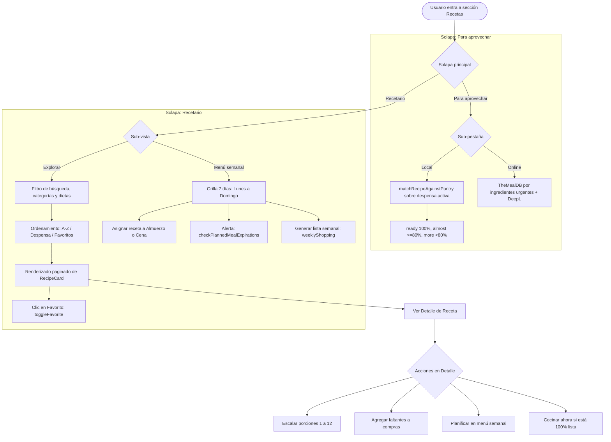

# Funcionalidad: Recetas, Recetario y Planificador Semanal

Este documento describe el módulo integral de recetas de FreshTrack: su doble arquitectura (recetario local offline y recetas en línea vía TheMealDB), el explorador completo de recetas regionales, el sistema de favoritos persistentes, el planificador semanal de comidas en horario local, el motor de matching con despensa y la generación agregada de lista de compras sin doble cómputo de stock.

---

## 1. Perspectiva del Usuario

El módulo de **Recetas** ofrece dos grandes áreas de trabajo accesibles mediante solapas superiores con persistencia de selección en la sesión (`freshtrack-recipes-main-tab` en `sessionStorage`):

### Solapa "Para aprovechar" (Priorización por Vencimiento)
Diseñada específicamente para evitar el desperdicio inmediato de alimentos. Se divide en dos sub-pestañas:
1. **"¿Qué puedo cocinar?" (Motor Local Instantáneo)**: Evalúa el inventario no vencido contra las 131 recetas regionales (`client/src/data/localRecipes.json`) clasificándolas en:
   - **"Podés hacer ahora" (Tier `ready`)**: 100% de ingredientes disponibles en despensa.
   - **"Te falta poco" (Tier `almost`)**: 80% o más de ingredientes disponibles. Permite enviar faltantes a compras con un toque.
   - **"Necesitás comprar más" (Tier `more`)**: Menos del 80% de ingredientes disponibles.
2. **"Aprovechar por vencer" (Motor TheMealDB)**: Consulta ingredientes críticos que vencen en los próximos 7 días contra TheMealDB y traduce al español rioplatense protegiendo términos locales.

### Solapa "Recetario" (Explorador, Favoritos y Planificador)
Diseñada para la planificación culinaria integral, permitiendo descubrir preparaciones y organizar la semana:
1. **Sub-vista "Explorar"**:
   - Acceso al catálogo completo de las 131 recetas locales sin requerir que los ingredientes estén en la despensa.
   - **Buscador en tiempo real**: Insensible a mayúsculas y acentos/diacríticos (busca tanto en el título como en los nombres de ingredientes).
   - **Filtros por categoría**: Lista dinámica extraída del catálogo (ej. Pastas, Carnes, Ensaladas, Sopas, etc.).
   - **Filtros dietarios rápidos**: Todas, Vegetarianas, Sin gluten y Rápidas (≤ 20 min).
   - **Criterios de ordenamiento**: Nombre (A-Z), Mayor coincidencia con despensa y Favoritas primero.
   - **Marcado de Favoritos**: Botón de estrella interactivo con persistencia local y atributo `aria-pressed`.
   - **Paginación incremental**: Carga inicial de 12 recetas con botón accesible "Cargar más recetas".
2. **Sub-vista "Menú semanal" (Planificador)**:
   - Grilla semanal de 7 días (de **Lunes a Domingo**) calculada en hora local.
   - Dos turnos por día: **Almuerzo** y **Cena**.
   - Asignación, sustitución y desasignación de recetas por turno.
   - **Detección preventiva de vencimientos**: Alerta al usuario si un ingrediente presente en la despensa vencerá *antes* del día programado para la comida.
   - **Generador de lista de compras semanal**: Consolida los faltantes de todas las comidas planificadas, escala porciones, convierte unidades compatibles y descuenta el stock de despensa sin doble cómputo, presentando un diálogo de confirmación con checkboxes.

---

## 2. Flujo y Arquitectura de Recetas



---

## 3. Buscador, Categorías y Filtros (`client/src/lib/cookbook.ts`)

- **Búsqueda Normalizada**: La función `normalizeSearchText(text)` remueve marcas diacríticas mediante `text.normalize("NFD").replace(/[\u0300-\u036f]/g, "")` y convierte a minúsculas, permitiendo que términos como `"milanesa"`, `"limón"`, `"pure"` o `"brócoli"` coincidan sin importar cómo escriba el usuario.
- **Categorías Dinámicas**: `getAvailableCategories(recipes)` analiza las categorías presentes en el catálogo y las ordena alfabéticamente.
- **Filtros Dietéticos**:
  - `vegetarian`: Descarta preparaciones con ingredientes cárnicos, pescados y derivados.
  - `glutenFree`: Verifica la ausencia de trigo, avena, cebada, centeno, harinas comunes y fideos convencionales.
  - `quick`: Identifica recetas cuyo tiempo estimado de preparación sea $\le 20$ minutos.
- **Ordenamiento Multicriterio**:
  - `"name-asc"`: Orden alfabético por título.
  - `"match-desc"`: Ordena según el porcentaje de disponibilidad de ingredientes en la despensa actual.
  - `"favorites-first"`: Ubica primero las recetas presentes en `freshtrack-favorite-recipes-v1`.

---

## 4. Persistencia de Favoritos (`client/src/lib/favoriteRecipes.ts`)

- **Almacenamiento**: Persistido en `localStorage` bajo la clave `freshtrack-favorite-recipes-v1` como `string[]` de IDs.
- **Operaciones**:
  - `loadFavorites()`: Recupera la lista tolerando datos corruptos y retornando un arreglo vacío ante excepciones.
  - `saveFavorites(ids)`: Guarda la lista con protección ante `QuotaExceededError`.
  - `toggleFavorite(recipeId)`: Agrega o remueve el identificador y notifica al usuario con Sonner Toast y vibración háptica.
  - `pruneFavoriteRecipes(validRecipeIds)`: Limpia de forma transparente identificadores huérfanos que ya no pertenezcan al catálogo.

---

## 5. Planificador Semanal (`client/src/lib/mealPlan.ts`)

- **Cálculo Local de Semanas**: Utiliza `getMondayOfWeek(d)` y `getWeekDates(monday)` basados en la fecha local (`getFullYear()`, `getMonth()`, `getDate()`), garantizando que la semana siempre comience el lunes y evitando el error de salto de día ocasionado por conversiones UTC a las 21:00 hs en husos horarios como el de Argentina (UTC-3).
- **Modelo de Datos `PlannedMeal`**:
  ```typescript
  export interface PlannedMeal {
    id: string;              // Identificador único (ej. "2026-10-05-lunch")
    date: string;            // Fecha ISO local YYYY-MM-DD
    slot: "lunch" | "dinner";// Turno
    recipeId: string;        // ID de la receta local
    portions: number;        // Porciones configuradas (por defecto según receta)
    createdAt: string;       // Timestamp ISO
  }
  ```
- **Retención y Poda Automática**: Al cargar el plan (`loadMealPlan`), se descartan automáticamente las comidas planificadas con más de 30 días de antigüedad para proteger la cuota de `localStorage`, además de remover recetas que hayan sido eliminadas del catálogo.
- **Detección Preventiva de Vencimientos**:
  `checkPlannedMealExpirations(meal, pantryProducts)` compara la fecha planificada de la comida (`meal.date`) contra las fechas de vencimiento de los productos en la despensa que coinciden con los ingredientes de la receta. Si un ingrediente vence antes de que se cocine la comida, genera un aviso con el nombre del producto, días de diferencia y fecha límite.

---

## 6. Generador de Lista de Compras Semanal (`client/src/lib/weeklyShopping.ts`)

La generación de compras a partir de la semana planificada resuelve tres problemas complejos de inventario culinario:

1. **Escalado Proporcional**:
   Cada ingrediente se escala según las porciones configuradas para la comida (`scaleMeasure(measure, meal.portions / recipe.servings)`).
2. **Consolidación de Unidades**:
   Si dos recetas de la semana requieren harina (ej. una pide 300 g y otra 500 g), se unifican en 800 g usando las conversiones de `quantity.ts` (g/kg, ml/l, unidades). Si las unidades no son convertibles directamente (ej. "1 taza" y "200 g"), se preservan ambas líneas discriminadas para evitar pérdidas de información.
3. **Deducción de Despensa sin Doble Cómputo**:
   El generador consulta los productos activos no vencidos de la despensa y calcula el faltante real descontando el stock disponible paso a paso:
   - Si la despensa tiene 500 g de harina y la semana requiere 800 g en total, el stock se consume una sola vez y la lista de compras solo solicita 300 g restantes.
   - Los productos ya vencidos se excluyen del stock disponible para no asumir existencias no aptas para consumo.
   - Las especias y condimentos sin cantidad numérica (`isNonNumericSpice`, como "sal a gusto" o "pimienta negra molida") se omiten automáticamente para no ensuciar la lista de compras con ítems ambiguos.
4. **Previsualización con Checkboxes**:
   Antes de escribir en `freshtrack-shopping-list-v1`, se presenta el diálogo modal con el listado de ingredientes faltantes pre-seleccionados, permitiendo al usuario desmarcar elementos que ya tenga en su hogar o prefiera no comprar.

---

## 7. Casos Borde y Resiliencia

- **Receta con porciones fraccionadas**: El escalado de porciones redondea a valores razonables (un decimal) para evitar indicaciones como "0.3333333 gramos".
- **Semana que cruza de mes o de año**: `getWeekDates` computa el avance día por día mediante `new Date(year, month, day + i)`, resolviendo naturalmente los cambios de mes y los años bisiestos.
- **Acceso sin conexión total**: La totalidad de las 131 recetas, la búsqueda, los filtros, los favoritos y el planificador semanal funcionan de forma 100% offline, ya que se alimentan de archivos JSON locales y almacenamiento en el navegador.

---

## 8. Pruebas Automatizadas

- `client/src/tests/cookbook.test.ts`: Búsqueda sin acentos, búsqueda en ingredientes, filtros dietarios y ordenamientos multicriterio.
- `client/src/tests/favoriteRecipes.test.ts`: Guardado, toggle, poda de huérfanos y resiliencia ante errores de `localStorage`.
- `client/src/tests/mealPlan.test.ts`: Inicio en lunes, cruces de mes/año, unicidad de turnos, poda a 30 días y detección de vencimientos previos.
- `client/src/tests/weeklyShopping.test.ts`: Escalado de porciones, suma de unidades convertibles, balance de despensa sin doble descuento y exclusión de especias no numéricas.
- `e2e/freshtrack.spec.ts`:
  - Escenario 5: Abrir recetario $\rightarrow$ marcar favorita $\rightarrow$ agregar faltantes a compras $\rightarrow$ verificar ítem en compras.
  - Escenario 6: Planificar dos recetas en el menú semanal $\rightarrow$ generar lista semanal $\rightarrow$ confirmar en diálogo.

---

## Enlaces Relacionados
- [Funcionalidad: Consumo de Ingredientes](consumo-de-ingredientes.md)
- [Funcionalidad: Lista de Compras](lista-de-compras.md)
- [Modelo de Datos y Almacenamiento](../06-modelo-de-datos-y-almacenamiento.md)
- [Referencia de Módulos lib/](../07-referencia-de-modulos-lib.md)
- [Componentes UI](../08-componentes-ui.md)

