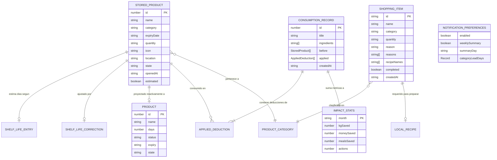

# Modelo de Datos y Almacenamiento

Este documento detalla la estructura de datos de FreshTrack, las interfaces TypeScript principales, la tabla exhaustiva de claves de `localStorage`, las estrategias de validación en tiempo de ejecución, el esquema de migraciones históricas (v1, v2 y v3) y el manejo de cuota de disco en el navegador.

---

## 1. Diagrama Entidad-Relación (ER)

El siguiente diagrama ilustra las entidades conceptuales del sistema, sus relaciones y multiplicidades:



---

## 2. Mapa Completo de Claves de `localStorage`

FreshTrack almacena la totalidad de su estado en el `localStorage` del navegador. A continuación se detallan todas las claves identificadas y verificadas en el código fuente:

| Clave de Almacenamiento | Tipo de Dato | Módulo Responsable | Contenido y Propósito | ¿Incluido en Backup? |
| :--- | :--- | :--- | :--- | :---: |
| `freshtrack-products-v3` | `StoredProduct[]` (JSON) | `client/src/lib/storage.ts` | Alimentos actualmente registrados en la despensa con formato ISO YYYY-MM-DD. | **Sí** |
| `freshtrack-products-v2` | `any[]` (JSON) | `client/src/lib/storage.ts` | **Clave legada**. Se lee para migrar a v3 y se destruye inmediatamente tras la migración. | No |
| `freshtrack-consumption-history-v3` | `ConsumptionRecord[]` (JSON) | `client/src/lib/storage.ts` | Historial de recetas cocinadas y alimentos descontados con snapshots para *undo*. | **Sí** |
| `freshtrack-consumption-history-v2` | `any[]` (JSON) | `client/src/lib/storage.ts` | **Clave legada**. Se elimina automáticamente al iniciar la app. | No |
| `freshtrack-consumption-history-v1` | `any[]` (JSON) | `client/src/lib/storage.ts` | **Clave legada**. Se elimina automáticamente al iniciar la app. | No |
| `freshtrack-shopping-list-v1` | `ShoppingItem[]` (JSON) | `client/src/lib/shoppingList.ts` | Ítems de la lista de compras con motivos, recetas asociadas y estado de compra. | **Sí** |
| `freshtrack-last-scan-v1` | `LastScanInfo` (JSON) | `client/src/lib/storage.ts` | Timestamp y cantidad de productos del último escaneo para la insignia de cabecera. | No |
| `freshtrack-shelf-corrections-v1` | `Record<string, ShelfLifeCorrection>` | `client/src/lib/shelfLifeCatalog.ts` | Ajustes manuales del usuario sobre días de conservación cerrado y abierto. | No |
| `freshtrack-date-learning-v1` | `DateLearningRule[]` (JSON) | `client/src/lib/dateRecognition.ts` | Reglas aprendidas de clasificación de fechas OCR por producto o categoría. | No |
| `freshtrack-impact-stats-v1` | `ImpactStats` (JSON) | `client/src/lib/impactStats.ts` | Métricas acumuladas del mes en curso (kg, dinero, comidas y acciones). | No |
| `freshtrack-expired-history-v1` | `HistoricalExpiredItem[]` (JSON) | `client/src/lib/reportsData.ts` | Registro histórico de alimentos que vencieron y fueron descartados. | No |
| `freshtrack-monthly-impact-history-v1` | `Record<string, { kg, money }>` | `client/src/lib/reportsData.ts` | Registro histórico de impacto agrupado por mes (YYYY-MM). | No |
| `freshtrack-recipe-i18n-v1` | `Record<string, RecipeSuggestion>` | `client/src/lib/recipeApi.ts` | Caché persistente de recetas traducidas provenientes de TheMealDB. | No |
| `freshtrack-notification-preferences-v1` | `NotificationPreferences` (JSON) | `client/src/lib/notificationRules.ts` | Preferencias de alertas, días de anticipación por categoría y resumen semanal. | No |
| `freshtrack-last-notification-date` | `string` (YYYY-MM-DD) | `client/src/lib/pwaAndNotifications.ts` | Fecha del último aviso emitido para asegurar el límite de 1 notificación diaria. | No |
| `theme` | `"light" \| "dark"` (string) | `client/src/contexts/ThemeContext.tsx` | Tema de interfaz activo persistido por el proveedor de contexto. | Parcial (`freshtrack-theme` en backup) |

---

## 3. Interfaces TypeScript Fundamentales

### `StoredProduct` y `Product` (`client/src/types/product.ts`)
```typescript
export type ProductStatus = "ok" | "soon" | "expired";
export type ProductState = "cerrado" | "abierto";

export interface StoredProduct {
  id: number;
  name: string;
  category: ProductCategory | string;
  expiryDate: string; // Formato estricto ISO YYYY-MM-DD
  quantity: string;
  icon: string;
  location?: string;
  estimated?: boolean;
  dateLabel?: DateLabel;
  corrected?: boolean;
  state?: ProductState;
  openedAt?: string; // Formato estricto ISO YYYY-MM-DD
  [key: string]: unknown;
}

export type Product = StoredProduct & {
  days: number;       // Días calendario relativos a today
  status: ProductStatus;
  expiry: string;     // Representación amigable (ej. "18 sep")
  state?: ProductState;
  openedAt?: string;
};
```

### `ShoppingItem` (`client/src/lib/shoppingList.ts`)
```typescript
export type ShoppingItemReason = "frecuente" | "stock_bajo" | "manual" | "vencido" | "receta";

export type ShoppingItem = {
  id: string;
  name: string;
  category: string;
  quantity: string;
  reason?: ShoppingItemReason;
  reasons?: ShoppingItemReason[];
  recipeNames?: string[];
  completed: boolean;
  createdAt: string;
  notes?: string;
};
```

### `ConsumptionRecord` (`client/src/lib/inventoryConsumption.ts`)
```typescript
export type AppliedDeduction = {
  itemId: number;
  deducted: string;
};

export type ConsumptionRecord = {
  id: number;
  title: string;
  ingredients: string[];
  before: StoredProduct[];
  applied: AppliedDeduction[];
  delta: { kg: number; money: number; meals: number };
  createdAt: string;
};
```

### `ImpactStats` (`client/src/lib/impactStats.ts`)
```typescript
export type ImpactStats = {
  month: string;       // Formato ISO "YYYY-MM"
  mealsSaved: number;
  kgSaved: number;
  moneySaved: number;
  actions: number;
};
```

### `NotificationPreferences` (`client/src/lib/notificationRules.ts`)
```typescript
export type AlertLeadDays = 1 | 3 | 7;

export type NotificationPreferences = {
  enabled: boolean;
  weeklySummary: boolean;
  summaryDay: "domingo" | "lunes";
  categoryLeadDays: Record<string, AlertLeadDays>;
};
```

### `ShelfLifeEntry` (`client/src/lib/shelfLifeCatalog.ts`)
```typescript
export type ShelfLifeEntry = {
  id: string;
  name: string;
  category: string;
  closedDays: number;
  openDays: number;
  agingDays?: number;
  aliases: string[];
  notes?: string;
};
```

### `LocalRecipe` (`client/src/lib/localRecipesMatching.ts`)
```typescript
export type LocalRecipeIngredient = {
  name: string;
  quantity?: string;
};

export type LocalRecipe = {
  id: string;
  name: string;
  category: string;
  ingredients: LocalRecipeIngredient[];
  instructions: string[];
  image?: string;
  tags?: string[];
  isOnline?: boolean;
};
```

### `RecipeSuggestion` (`client/src/lib/recipeApi.ts`)
```typescript
export type RecipeIngredient = {
  name: string;
  measure: string;
};

export type RecipeSuggestion = {
  id: string;
  title: string;
  image: string;
  area?: string;
  category?: string;
  matchedIngredients: string[];
  source: "TheMealDB" | "FreshTrack";
  url?: string;
  ingredients?: RecipeIngredient[];
  instructions?: string;
  isLocalFallback?: boolean;
  isOriginalEnglish?: boolean;
  isGlutenFreeEstimated?: boolean;
  pantryMatchRatio?: { matched: number; total: number };
  sourceLanguage?: string;
};
```

### `FreshTrackBackup` (`client/src/lib/backup.ts`)
```typescript
export interface FreshTrackBackup {
  version: number;
  exportedAt: string;
  products: StoredProduct[];
  consumptionHistory: any[];
  shoppingList: any[];
  theme?: string;
}
```

---

## 4. Validación de Esquema (`isValidStoredProduct`)

Para evitar que datos corruptos, cadenas vacías o fechas inválidas rompan la interfaz, la función `isValidStoredProduct()` en `client/src/lib/storage.ts` audita en tiempo de ejecución cada objeto antes de cargarlo o guardarlo:

```typescript
export function isValidStoredProduct(item: any): item is StoredProduct {
  if (!item || typeof item !== "object") return false;
  if (typeof item.id !== "number" && typeof item.id !== "string") return false;
  if (typeof item.name !== "string" || !item.name.trim()) return false;
  if (typeof item.category !== "string") return false;
  if (typeof item.expiryDate !== "string" || !/^\d{4}-\d{2}-\d{2}$/.test(item.expiryDate)) {
    return false;
  }
  // Validación de fecha real de calendario (rechaza días inexistentes como 31-02)
  const [y, m, d] = item.expiryDate.split("-").map(Number);
  const dateObj = new Date(y, m - 1, d);
  if (
    dateObj.getFullYear() !== y ||
    dateObj.getMonth() !== m - 1 ||
    dateObj.getDate() !== d
  ) {
    return false;
  }
  if (typeof item.quantity !== "string") return false;
  if (typeof item.icon !== "string") return false;

  return true;
}
```

---

## 5. Estrategia de Migraciones: v1 $\rightarrow$ v2 $\rightarrow$ v3

A lo largo de la evolución de FreshTrack, el almacenamiento de productos transitó tres versiones:
- **v1 (`freshtrack-consumption-history-v1`)**: Versión inicial temprana. En la actualidad, el sistema detecta si esta clave existe y la remueve para liberar cuota.
- **v2 (`freshtrack-products-v2`)**: Almacenaba un valor entero `days: number` directamente en el registro. Si el usuario abría la aplicación semanas después, ese número resultaba anacrónico y causaba inconsistencias.
- **v3 (`freshtrack-products-v3`)**: Esquema definitivo actual. Elimina el campo `days` y adopta `expiryDate: string` en formato estricto ISO `YYYY-MM-DD`.

### Proceso de Migración Automática (`loadStoredProducts`)
Cuando `loadStoredProducts()` no encuentra la clave `freshtrack-products-v3` pero detecta `freshtrack-products-v2`:
1. Parsea el arreglo de productos legados v2.
2. Si un ítem ya poseía `expiryDate` ISO válida, la respeta; de lo contrario, deriva la fecha proyectada: `expiryDate = addDaysISO(item.days || 7, today)`.
3. Normaliza las propiedades (`name`, `category`, `quantity`, `icon`).
4. Valida cada ítem con `isValidStoredProduct()`.
5. Guarda el arreglo resultante en `freshtrack-products-v3` mediante `saveJSON()`.
6. **Destruye de forma segura** la clave vieja: `localStorage.removeItem(OLD_PRODUCTS_STORAGE_KEY)`.

---

## 6. Manejo de Cuota de Disco Excedida (`QuotaExceededError`)

La función genérica `saveJSON<T>(key, value)` en `client/src/lib/storage.ts` envuelve toda escritura a `localStorage` en un bloque `try/catch` con discriminación de errores de cuota:

```typescript
export function saveJSON<T>(key: string, value: T): boolean {
  if (typeof localStorage === "undefined") return false;
  try {
    localStorage.setItem(key, JSON.stringify(value));
    return true;
  } catch (error) {
    if (
      error instanceof DOMException &&
      (error.name === "QuotaExceededError" || error.code === 22)
    ) {
      console.error(`Storage quota exceeded while saving key "${key}".`);
    } else {
      console.error(`Error saving JSON to localStorage key "${key}":`, error);
    }
    return false;
  }
}
```

Si el almacenamiento alcanza el límite del navegador (habitualmente 5 MB a 10 MB en Web Storage), la función retorna `false` de forma segura evitando excepciones no controladas que detendrían la ejecución del hilo de React.

---

## Enlaces Relacionados
- [Arquitectura del Sistema](02-arquitectura.md)
- [Funcionalidad: Despensa](05-funcionalidades/despensa.md)
- [Funcionalidad: Backup y Exportación](05-funcionalidades/backup-y-exportacion.md)
- [Referencia de Módulos lib/](07-referencia-de-modulos-lib.md)
- [Limitaciones y Deuda Técnica](14-limitaciones-y-deuda-tecnica.md)
